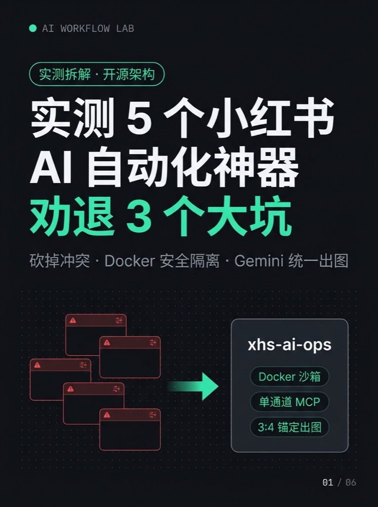
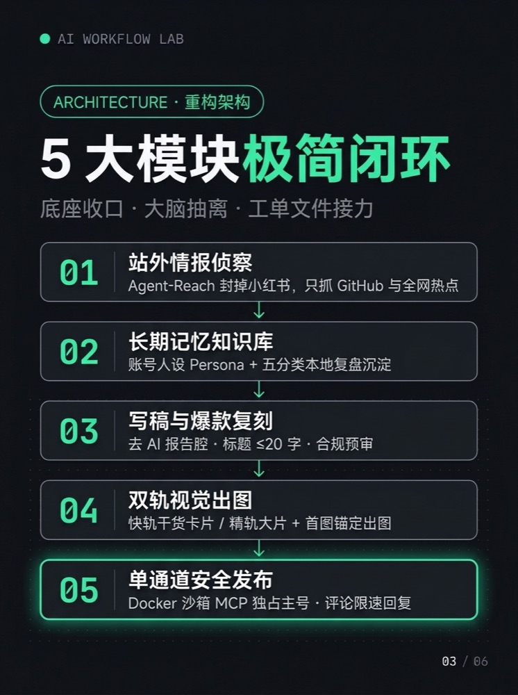
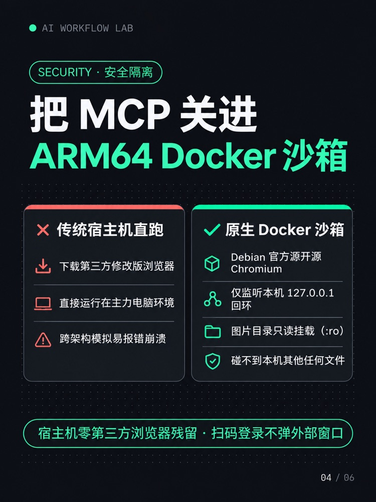
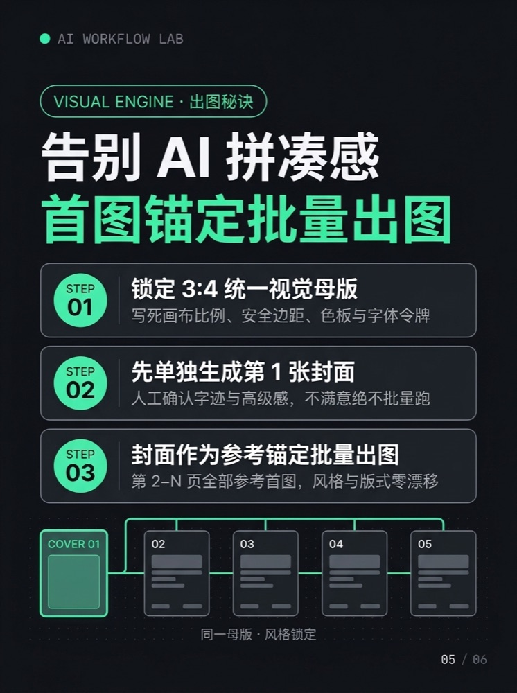
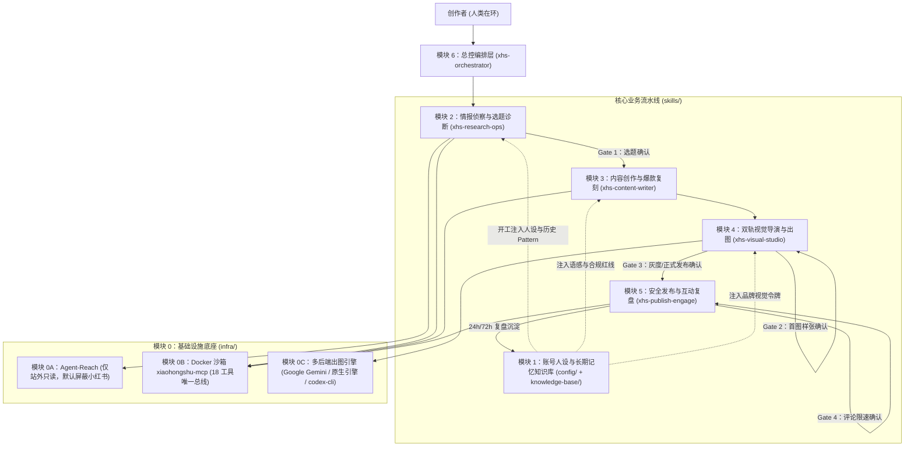

# xhs-ai-ops · 小红书 AI 全链路模块化运营工作台

<p align="center">
  <strong>把 5 个高星开源项目去重重构，打通「站外选题 → 爆款复刻 → 双轨 3:4 锚定出图 → Docker 安全沙箱发布 → 评论风控复盘」的完整 AI Agent 工程工作台</strong>
</p>

<p align="center">
  
  
  
  
</p>

---

## 一、为什么不直接拼装网传的 5 个开源项目？

市面上流传着“5 个 GitHub 神器一键自动运营小红书”的工具清单（`Agent-Reach` + `xiaohongshu-ops-skill` + `xhs-visual-director-skill` + `baoyu-xhs-images` + `xiaohongshu-mcp`）。

经过源码级实测，直接照搬全装会踩到 **4 个致命工程坑**，`xhs-ai-ops` 正是为了解决这些冲突而做的模块化重构：

| 痛点 | 直接硬拼 5 个项目 | `xhs-ai-ops` 重构解法 |
| :--- | :--- | :--- |
| **1. 主号互踢与风控** | `Agent-Reach`、`ops-skill`（CDP）与 `xiaohongshu-mcp` 三套通道都在操作小红书网页端，同登主号极易互踢限流 | **单通道收口**：`infra/reach.sh` 默认拦截小红书仅抓站外热点；站内 18 项读写、发帖与通知全部统一走 `xiaohongshu-mcp` 单会话 |
| **2. 宿主机安全隐患 & 跨架构崩溃** | 默认在宿主机下载第三方 CDN 未公证的定制 Chromium；Apple Silicon Mac 跑官方 `amd64` 镜像易触发 QEMU 崩溃 | **原生 Docker 安全沙箱**：本地构建原生 `arm64/amd64` 镜像，改用 **Debian 官方源开源 Chromium**，仅监听 `127.0.0.1`，工单图片目录**只读挂载（`:ro`）** |
| **3. 两个视觉 Skill 互相打架** | 一个强制“前置 10 问”不自带出图后端，另一个自带卡片交互确认，挂一起反复冲突 | **双轨视觉导演 + 首图锚定**：干货走快轨（`baoyu-xhs-images`），大片走精轨（`xhs-visual-director`）；先出第 1 张封面确认，再作为 `--ref` 锚定批量生成第 2–N 页，并兼容跨引擎补图 |
| **4. 缺少数据接力与人工防线** | 5 个项目出自不同作者，输入输出无统一格式，也缺乏发布与评论风控拦截 | **工单状态机 + 4 道人工关卡**：以 `workspace/posts/<date>-<slug>/` 为唯一事实来源，在选题、封面、发布（默认先发`仅自己可见`）、评论发送设 4 道强制人工确认门禁 |

---

## 二、真实成图效果展示（首图锚定 · 3:4 竖版）

以下示例全部由本工作台「精轨视觉母版 + 首图 `--ref` 锚定链」实际生成（含跨模型参考图补齐验证），零错字、手机端高可读、严格 `3:4` 竖版：

| Page 01 · 封面 | Page 03 · 重构架构 | Page 04 · 安全隔离 | Page 05 · 出图秘诀 |
| :---: | :---: | :---: | :---: |
|  |  |  |  |

---

## 三、总体系统架构（六大模块 + 四道人工关卡）



---

## 四、模块划分与目录结构

```text
xhs-ai-ops/
├── config/                          # 模块 1：账号人设、视觉母版与环境配置模板
│   ├── persona.md                   # AI 垂类人设、内容支柱、去报告腔语感与合规红线
│   ├── brand-visual.md              # 3:4 双轨视觉母版、色板与出图策略
│   └── .env.example                 # 环境变量模板（真实 .env 自动被 .gitignore 忽略）
├── infra/                           # 模块 0：基础设施编排、Docker 安全沙箱与自检脚本
│   ├── bootstrap.sh                 # 一键拉取 5 个上游仓库至 upstream/ 并安装 .venv
│   ├── Dockerfile.arm64             # 原生架构沙箱镜像（Debian 官方开源 Chromium）
│   ├── build-arm64-image.sh         # 自动识别 arm64/amd64 编译并打包（含 2026 创作者中心兼容）
│   ├── docker-compose.yml           # 仅绑定 127.0.0.1 + 工单目录只读挂载 (:ro) + 禁提权
│   ├── start-mcp.sh                 # 容器托管：start | stop | restart | status | logs
│   ├── login-xhs.sh                 # 容器无界面二维码扫码登录（宿主机绝不弹第三方浏览器）
│   ├── reach.sh                     # Agent-Reach 封装（内置单主号风控护盾 + macOS SSL 修复）
│   ├── gen-image.sh                 # baoyu-image-gen 统一出图封装（支持 Gemini / codex-cli 等 12 后端）
│   ├── install-skills.sh            # 一键注册 Skills & MCP 到 Antigravity / Claude / Codex / OpenClaw
│   └── doctor.sh                    # 全链路 13 项环境一键健康体检
├── knowledge-base/                  # 模块 1：五分类长期运营记忆库（本地沉淀，自动忽略隐私文件）
│   ├── README.md                    # 总览入口与检索铁律
│   ├── accounts/                    # 账号五维体检基线
│   ├── topics/                      # 高分选题池与标题骨架
│   ├── patterns/                    # 高藏赞比爆款模式沉淀
│   ├── actions/                     # 发布与回复执行留痕
│   └── reviews/                     # 24h / 72h 数据复盘归因
├── skills/                          # 模块 2–6：五大零冲突模块化 Agent Skills
│   ├── xhs-orchestrator/            # 模块 6：总控 5 阶段状态机与 4 道人工关卡调度
│   ├── xhs-research-ops/            # 模块 2：站外热点 + 站内对标 + 账号五维体检 + 选题打分
│   ├── xhs-content-writer/          # 模块 3：原创五元组写稿 + 爆款 style-only 复刻 + 合规预审
│   ├── xhs-visual-studio/           # 模块 4：双轨视觉导演 + 母版协议 + 首图锚定批量出图
│   └── xhs-publish-engage/          # 模块 5：灰度/定时安全发布 + 通知评论风控回复 + 数据复盘
├── workspace/posts/                 # 运行期工单目录（每篇独立状态机 state.yaml + 01~07 工件）
├── docs/showcase/                   # 脱敏成图效果展示
└── upstream/                        # [gitignore] 执行 ./infra/bootstrap.sh 后自动拉取的 5 个上游仓库
```

---

## 五、3 分钟快速上手

### 前置要求
- `Git`、`Python 3.10+`、`Node.js 18+`（提供 `npx`）、`Go 1.24+`、`Docker`（Docker Desktop / OrbStack / Linux Docker）
- 任一支持 Agent Skills 与 MCP 的 AI 客户端（如 **Antigravity**、`Claude Code`、`Codex`、`OpenClaw`）

### 第 1 步：克隆并一键初始化上游底座
```bash
git clone https://github.com/zhushuaiCoding/xhs-ai-ops.git
cd xhs-ai-ops
./infra/bootstrap.sh
```
> 脚本会自动拉齐 5 个上游仓库到 `upstream/`、创建隔离的 `.venv` 安装 `Agent-Reach`，并生成 `config/.env`。按需在 `config/.env`（或系统环境变量）中填写生图密钥（如 `GOOGLE_API_KEY`），也可使用宿主内置生图引擎或 `codex-cli`。

### 第 2 步：启动原生 Docker 安全沙箱并扫码登录主号
先确保本地 **Docker Desktop** 已启动，再执行：
```bash
# 首次运行自动识别本机架构（arm64/amd64）构建基于 Debian 官方开源 Chromium 的原生沙箱镜像
./infra/start-mcp.sh start

# 从容器拉取纯二维码 PNG 并用系统预览打开，手机小红书 App 扫码即可（宿主机零第三方浏览器）
./infra/login-xhs.sh
```
> ⚠️ **单主号安全铁律**：扫码登录后，请勿再在其他电脑网页端登录同一小红书主号（会触发会话互踢）；日常查看主页、预览`仅自己可见`笔记或改资料请直接使用手机端 App。

### 第 3 步：注册 Skills 与 MCP 并执行一键体检
```bash
# 默认注册到 Antigravity（支持 --target antigravity|claude|codex|openclaw|all）
./infra/install-skills.sh

# 一键体检（确认全部绿灯、宿主机零非官方浏览器残留）
./infra/doctor.sh
```

---

## 六、在 AI 客户端中的日常使用范例

完成注册并重载 MCP 后，直接用自然语言对话驱动即可：

- **端到端跑一篇新笔记**：`用 xhs-orchestrator 帮我找 3 个本周 GitHub 最火的 AI Agent 选题，准备发一篇小红书图文`
- **做账号五维体检**：`用 xhs-research-ops 帮我体检一下我的小红书主号最近 10 篇笔记`
- **爆款结构复刻**：`用 xhs-content-writer 帮我按 style-only 拆解复刻这篇爆款笔记的结构：<链接或关键词>`
- **长文直出 3:4 卡片**：`用 xhs-visual-studio 把我这段技术文章做成 6 页小红书图文卡片`
- **评论无痕巡检与风控回复**：`用 xhs-publish-engage 查一下有没有新评论，先列出摘要和回复草案别直接发`
- **发布后数据复盘**：`用 xhs-publish-engage 复盘昨天发的笔记数据，并把有效模式沉淀到知识库`

---

## 七、致谢与上游开源项目

本项目为模块化编排与安全工程化整合层，核心能力建立在以下 5 个优秀开源项目之上（通过 `infra/bootstrap.sh` 按各自上游协议独立拉取，未修改上游版权声明）：

1. **[Panniantong/Agent-Reach](https://github.com/Panniantong/Agent-Reach)** — 多平台只读互联网检索与内容读取 CLI
2. **[xpzouying/xiaohongshu-mcp](https://github.com/xpzouying/xiaohongshu-mcp)** — 小红书标准 MCP Server（18 项工具与拟人化操作引擎）
3. **[Xiangyu-CAS/xiaohongshu-ops-skill](https://github.com/Xiangyu-CAS/xiaohongshu-ops-skill)** — 小红书账号诊断、推荐流分析、爆款复刻与本地知识库方法论
4. **[ziguishian/xhs-visual-director-skill](https://github.com/ziguishian/xhs-visual-director-skill)** — 24 套高级小红书视觉风格体系、统一视觉母版与反模式审查规范
5. **[JimLiu/baoyu-skills](https://github.com/JimLiu/baoyu-skills)** — `baoyu-xhs-images` 图文卡片工作流、`baoyu-image-gen` 多后端并发出图引擎与首图锚定链设计

## 八、免责声明与开源协议

- 本项目仅用于个人内容创作效率提升、技术学习与工作流研究，请严格遵守小红书平台社区规范与相关法律法规；严禁用于批量刷量、垃圾营销、搬运抄袭或未经授权的数据爬取。
- 仓库编排脚本、模块化 Skill 与文档采用 [MIT License](./LICENSE) 开源。
